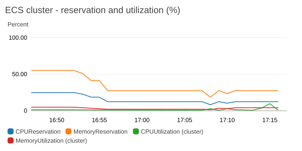
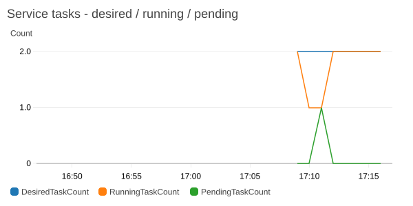
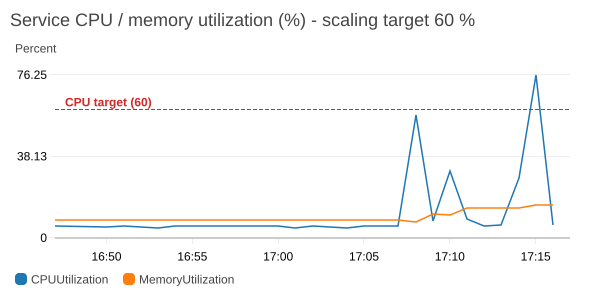
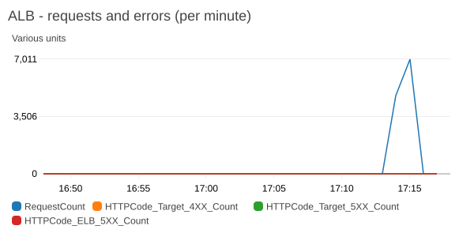
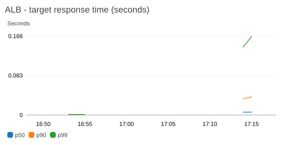
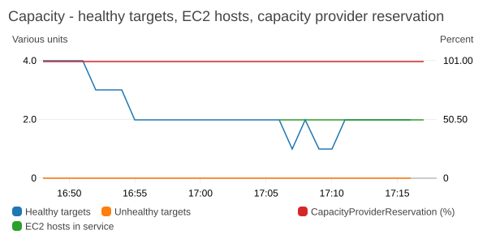
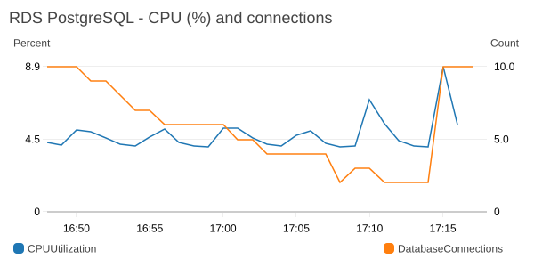

# Containerized Microservices on Amazon ECS (CloudFormation)

A Python **Product Service** (`GET /products`, data in Amazon RDS for PostgreSQL), packaged as a
Docker image, stored in Amazon ECR and run on Amazon ECS. The project grows one exercise at a
time: ECS on EC2 → ECS Service + ALB + Auto Scaling → monitoring → CodePipeline/CodeDeploy
blue/green → Fargate and Fargate Spot → Secrets Manager → Aurora Global Database → cost estimate.
At the end, Project 3's orders API is ported to a second ECS service. Every exercise extends the
same `template.yaml` and is deployed as an update to a single CloudFormation stack.

| | |
|---|---|
| **IaC** | AWS CloudFormation: one template, one stack (`containerized-microservices`) |
| **Runtime** | Python 3.12, FastAPI + uvicorn, psycopg 3; container on port 3000, arm64 (Graviton) |
| **Regions** | us-east-1 (primary), us-west-2 (Aurora Global Database secondary) |
| **CI/CD** | AWS CodePipeline (GitHub via CodeConnections) → CodeBuild → CodeDeploy ECS blue/green |
| **Status** | 🚧 In progress |

## Progress

| # | Exercise | Services | Status |
|---|---|---|---|
| 0 | Project setup | git, Python venv, cfn-lint | ✅ Done |
| 1 | Build container | Docker | ✅ Done |
| 2 | Push image to registry | Amazon ECR | ✅ Done |
| 3 | Deploy container as a task | Amazon ECS (EC2), VPC, RDS | ✅ Done |
| 4 | Scale with an ECS Service | ECS Service, ALB, Auto Scaling | ✅ Done |
| 5 | Monitoring | CloudWatch, Container Insights, X-Ray | ✅ Done |
| 6 | CI/CD pipeline | CodePipeline, CodeBuild, CodeDeploy (blue/green) | ✅ Done |
| 7 | Replace EC2 with Fargate | AWS Fargate | ⏳ Next |
| 8 | Spot capacity | Fargate Spot capacity providers | ⬜ |
| 9 | Database credentials | AWS Secrets Manager | ⬜ |
| 10 | Disaster recovery | Aurora Global Database | ⬜ |
| 11 | Cost estimate | AWS Pricing Calculator | ⬜ |
| 12 | Real-world project | Orders service (Project 3) on ECS | ⬜ |
| 13 | Close-out | Well-Architected review, teardown/rebuild | ⬜ |

## Process

The project uses the same working agreement as the other portfolio projects:

1. **Plan first.** The exercise sheet was turned into the phase plan below. Up-front decisions
   (runtime, database, networking, CI/CD, repo) were made before any code was written.
2. **One phase at a time.** For each phase: edit code/template → `pytest` → `cfn-lint` → deploy →
   verify with the CLI/curl → console check → README update → commit + push. Then **stop** for a
   go-ahead before the next phase.
3. **Cost toggles.** Hourly-billed resources sit behind template parameters (`EnableCompute`,
   `EnableDatabase`). They are switched on for a demo and off again with explicit
   `--parameter-overrides`.
4. **One deploy identity.** Every resource is deployed by account `977534234172`, IAM user
   `arn:aws:iam::977534234172:user/sriram` (AWS profile `default`). Scripts abort if
   `aws sts get-caller-identity` returns any other identity.
5. **Document as we go.** Every phase adds a [build log](#build-log) entry with the commands that
   were run, what was observed (real numbers), and any errors with their root cause and fix.

### Up-front decisions

| Topic | Decision | Why |
|---|---|---|
| Runtime | Python 3.12 + FastAPI (sheet says Node.js) | Same language as Projects 3/4; FastAPI is small and async, and generates OpenAPI docs |
| IaC | Plain CloudFormation | Named by the exercise sheet; no Lambda here, so SAM adds nothing |
| Database | RDS PostgreSQL 16, db.t4g.micro, single-AZ, toggle | Cheapest RDS option for a demo; migrated to Aurora for the DR exercise |
| Networking | Private subnets + VPC endpoints, no NAT gateway | No internet egress from tasks or the DB; ALB in public subnets |
| CPU architecture | arm64 (Graviton) | Lower price per vCPU; same for EC2 and Fargate |
| CI/CD | CodePipeline + CodeBuild + CodeDeploy blue/green | Named by the exercise sheet; GitHub source via CodeConnections |
| Monitoring | ECS/ALB/RDS metrics + X-Ray via ADOT sidecar | The sheet's Lambda metrics don't apply to a container workload |
| Real-world exercise | Project 3 orders API as a 2nd ECS service | Two microservices behind one ALB with path routing |
| Teardown | Everything removed at the end with the same IaC | No running cost after the project |

### Phase plan

| # | What gets built |
|---|---|
| 1 | FastAPI app (`GET /products`, `GET /health`), seed script, multi-stage Dockerfile (non-root, healthcheck), unit tests, `docker compose` with local Postgres |
| 2 | `AWS::ECR::Repository` `product-service` (scan on push, immutable tags, lifecycle policy); manual login/build/tag/push commands |
| 3 | VPC (2 AZs, no NAT), VPC endpoints, security groups, RDS PostgreSQL, ECS cluster with an EC2 capacity provider (t4g.small ASG), IAM roles, log group, task definition; standalone tasks via `aws ecs run-task` (seed + API) |
| 4 | ALB + target group, ECS Service (2 tasks across AZs), target-tracking auto scaling, capacity provider managed scaling; load test |
| 5 | Container Insights, CloudWatch dashboard (ECS reservation/task counts, ALB requests/4XX/5XX/latency, RDS), X-Ray tracing |
| 6 | CodeConnections, CodeBuild (`buildspec.yml`), CodePipeline, CodeDeploy blue/green (`appspec.yaml`, 2 target groups, test listener), rollback test |
| 7 | Migrate the service from EC2 to Fargate, remove the EC2 capacity |
| 8 | `FARGATE` + `FARGATE_SPOT` capacity provider strategy |
| 9 | Secrets Manager secret for DB credentials, injected through task definition `secrets` |
| 10 | Aurora PostgreSQL Global Database (us-east-1 primary, us-west-2 secondary), replication lag, switchover drill |
| 11 | `docs/cost-estimate.md` + AWS Pricing Calculator link |
| 12 | Orders service (FastAPI, DynamoDB, Cognito JWT) as a second ECS service behind `/orders*` |
| 13 | Well-Architected review, scripted teardown and rebuild, final teardown |

## Build log

### Phase 0 — Project setup (2026-11-01)

**Environment check** (the shell's `AWS_PROFILE` points to a different account, so every AWS
command pins `--profile default`):

```bash
aws sts get-caller-identity --profile default   # account 977534234172, user sriram
py -3.12 --version                               # Python 3.12.10
docker info --format '{{.ServerVersion}}'        # Docker Desktop not running yet
docker buildx version                            # v0.35.0 (needed for arm64 builds)
git --version                                    # 2.54.0
df -h /c                                         # 132 GB free
```

**Repository and tooling:**

```bash
git init -b main
git config user.name  "Sriram Penumatcha"
git config user.email "93265789+sriram-um@users.noreply.github.com"
py -3.12 -m venv .venv
.venv/Scripts/python -m pip install cfn-lint pytest   # cfn-lint 1.59.0
```

Files added: `.gitignore` (venv, caches, `*.env`), `.gitattributes` (`* text=auto eol=lf`, because
the code is checked out on Windows but built on Linux in CodeBuild), `pytest.ini`
(test paths limited to the service test folders, so pytest never collects the live-AWS scripts in
`scripts/`).

**Observations:** Docker Desktop has to be started by hand before any container work.

### Phase 1 — Build the container (Docker) (2026-11-01)

**What was built**

| File | Purpose |
|---|---|
| [`product_service/main.py`](services/product-service/product_service/main.py) | FastAPI app: `GET /products`, `GET /health`. Connection pool opened at startup without waiting for the DB |
| [`product_service/repository.py`](services/product-service/product_service/repository.py) | SQL for the `products` table; `NUMERIC` → JSON number |
| [`product_service/config.py`](services/product-service/product_service/config.py) | Settings from env vars `DB_HOST/DB_PORT/DB_NAME/DB_USER/DB_PASSWORD/DB_SSLMODE/APP_VERSION` |
| [`product_service/seed.py`](services/product-service/product_service/seed.py) | Creates the table and 5 sample products; idempotent (`ON CONFLICT (sku) DO NOTHING`) |
| [`Dockerfile`](services/product-service/Dockerfile) | Multi-stage, pinned base `python:3.12.16-slim-trixie`, non-root user, port 3000, `HEALTHCHECK` |
| [`.dockerignore`](services/product-service/.dockerignore) | Allow-list: only `requirements.txt` and `product_service/` go into the build context |
| [`tests/test_main.py`](services/product-service/tests/test_main.py) | 7 unit tests; the repository is replaced through FastAPI dependency overrides |
| [`docker-compose.yml`](docker-compose.yml) | Local Postgres 16 → seed job → service, ordered by health/completion conditions |

**API**

| Request | Response |
|---|---|
| `GET /products` | `200 {"products": [{"id", "sku", "name", "description", "price", "stock"}], "count": n}` |
| `GET /products`, database unreachable | `503 {"message": "Database unavailable"}` (after at most 5 s pool wait) |
| `GET /health` | `200 {"status": "ok", "app_version": "…"}`; never touches the DB, so a DB outage doesn't make ECS/ALB kill healthy tasks |

**Dockerfile design**

- **Builder stage** creates `/opt/venv` and installs only `requirements.txt` (no test tools). It
  then uninstalls the venv's own `pip`, which saves ~13 MB.
- **Runtime stage** starts again from the slim base and copies just the venv and the code. There
  are no compilers, no pip cache and no build files. `psycopg[binary]` ships its own libpq, so no
  `apt-get` is needed.
- Runs as non-root user `app` (uid 10001). `PYTHONDONTWRITEBYTECODE`/`PYTHONUNBUFFERED` are set, so
  logs reach `docker logs`/CloudWatch immediately.
- Exec-form `CMD`, so uvicorn is PID 1 and gets ECS's `SIGTERM`. `--proxy-headers` makes it trust
  the ALB's `X-Forwarded-*` headers.
- `HEALTHCHECK` uses Python's `urllib`, because the slim image has no curl. ECS ignores Dockerfile
  health checks, so the task definition will declare the same check in Phase 3.

**Commands run**

```bash
.venv/Scripts/python -m pip install -r services/product-service/requirements-dev.txt
.venv/Scripts/python -m pytest -q                          # 7 passed
docker build -t product-service:local services/product-service
docker compose up --build -d
curl localhost:3000/products
docker compose run --rm seed                               # second run: still 5 products
docker compose stop db; curl localhost:3000/products       # 503; /health still 200
docker compose start db; curl localhost:3000/products      # 200 again, no restart needed
docker compose stop product-service                        # graceful SIGTERM shutdown
docker buildx build --platform linux/arm64 -t product-service:arm64 --load services/product-service
docker compose down -v
```

**Measured**

| What | Result |
|---|---|
| Unit tests | 7 passed in 1.4 s |
| Image size (compressed, `docker image inspect`) | base 43 MB → **multi-stage 54 MB** (+11 MB). A naive single-stage build with dev deps and pip cache: 76 MB (+33 MB) |
| venv size (uncompressed) | 53 MB → 40 MB after removing pip |
| Build time, amd64 native | 38 s (cold) |
| Build time, **arm64 under QEMU emulation** | **290 s** (7.6× slower) |
| arm64 image | 56.7 MB, `aarch64`, psycopg `binary` implementation loads |
| `GET /products` warm latency, local (20 calls) | min 6.7 ms, p50 8.7 ms, max 100 ms (first call) |
| Compose start → container `healthy` | ~8 s |
| DB stopped → `GET /products` | `503` in 8 ms (refused connection fails fast); recovers by itself when the DB is back |
| `docker compose stop` (SIGTERM) | 1.9 s, exit code 0 (`Shutting down` → `Finished server process`) |

**Issues hit and fixes**

| Symptom | Cause | Fix |
|---|---|---|
| `StarletteDeprecationWarning: Using httpx with starlette.testclient is deprecated` | Starlette 1.x moved its TestClient to `httpx2` | Dev dependency `httpx2==2.16.0` instead of `httpx` |
| `cat: 'C:/Program Files/Git/etc/os-release'` from `docker run … cat /etc/os-release` | Git Bash rewrote the container path | `MSYS_NO_PATHCONV=1 docker run …` |
| Docker Desktop sizes look wrong (`docker images`: base 384 MB, our image 248 MB) | With the containerd image store, `docker images` shows a different measure than `docker image inspect` | Compare with `docker image inspect --format '{{.Size}}'` (compressed); ECR's `imageSizeInBytes` will confirm in Phase 2 |
| Size-comparison build failed at `pip install -r requirements-dev.txt` | The allow-list `.dockerignore` excludes everything except the runtime files (working as intended) | Built the comparison image from a temp copy outside the repo |

### Phase 2 — Push the image to Amazon ECR (2026-11-01)

**What was built**

| Resource / file | Details |
|---|---|
| [`template.yaml`](template.yaml) → `AWS::ECR::Repository` **`product-service`** | Immutable tags, scan on push (basic), AES256 encryption, `EmptyOnDelete: true` (teardown works with images inside), lifecycle policy: expire untagged after 1 day, keep the 10 newest images |
| Stack **`containerized-microservices`** (us-east-1) | First deploy of the single project stack; outputs `ProductServiceRepositoryUri`, `ProductServiceRepositoryArn` |
| [`scripts/lib.sh`](scripts/lib.sh) | Pins `AWS_PROFILE=default`, us-east-1; `check_identity` aborts unless the caller is `arn:aws:iam::977534234172:user/sriram` |
| [`scripts/deploy.sh`](scripts/deploy.sh) | `cfn-lint` → `aws cloudformation deploy` with tags `project=containerized-microservices`; optional `Key=Value` parameter overrides |
| [`scripts/push_image.sh`](scripts/push_image.sh) | The four manual ECR steps below; refuses to run with uncommitted service code (the tag must match the code) and skips tags that already exist |

**Manual ECR commands** (what `scripts/push_image.sh` runs):

```bash
export AWS_PROFILE=default AWS_REGION=us-east-1
REPO_URI=977534234172.dkr.ecr.us-east-1.amazonaws.com/product-service
TAG=$(git rev-parse --short=7 HEAD)                       # f48cc4e

# 1. Authenticate Docker with ECR (token valid for 12 h)
aws ecr get-login-password | docker login --username AWS --password-stdin 977534234172.dkr.ecr.us-east-1.amazonaws.com

# 2. Build the image for arm64 (Graviton)
docker buildx build --platform linux/arm64 --provenance=false --sbom=false \
  -t product-service:$TAG --load services/product-service

# 3. Tag it with the ECR repository URI
docker tag product-service:$TAG $REPO_URI:$TAG

# 4. Push
docker push $REPO_URI:$TAG
```

**Why the git SHA as the tag (and no `latest`)?** With immutable tags, a tag always identifies
exactly one image, so a task definition that references `:f48cc4e` can't change under a running
service. Rollback means deploying the previous SHA. `latest` would need mutable tags.

**Why `--provenance=false --sbom=false`?** By default BuildKit attaches attestation manifests and
pushes an image *index*. ECR lists the attestations as extra untagged artifacts, and the "expire
untagged" lifecycle rule would act on them. A single image manifest keeps the repository clean
(`imageManifestMediaType: application/vnd.oci.image.manifest.v1+json`).

**Verification**

```bash
aws ecr describe-images --repository-name product-service --image-ids imageTag=f48cc4e
aws ecr describe-image-scan-findings --repository-name product-service --image-id imageTag=f48cc4e
```

**Measured**

| What | Result |
|---|---|
| Stack create (ECR repository) | 50 s, `CREATE_COMPLETE` |
| `push_image.sh` end to end | 31 s (the arm64 layers were cached from Phase 1; a cold arm64 build is ~290 s) |
| Image in ECR | tag `f48cc4e`, **56.7 MB** (`imageSizeInBytes` 56 701 890), single OCI manifest, digest `sha256:f6a902b8…` |
| Basic scan | complete 13 s after push: **5 HIGH, 10 MEDIUM, 3 LOW** |
| Findings by package | glibc 15, sqlite3 2, zlib 1. All are Debian base-image packages, none are Python dependencies |
| Fixes available? | No: `apt list --upgradable` in the base image shows no newer libc6 / libsqlite3-0 / zlib1g in Debian 13 |

**Scan decision:** accepted for now, because no fixed packages exist yet and `apt-get upgrade`
would change nothing. Re-check on every rebuild; the pinned base tag gets bumped when Debian
ships fixes. Basic scanning only covers OS packages. Amazon Inspector enhanced scanning would also
cover the Python packages, but it costs money and is left off. A smaller attack surface (a
distroless or Chainguard Python base without sqlite3) is a possible later optimization.

**Console links (us-east-1)**
- ECR repository: https://us-east-1.console.aws.amazon.com/ecr/repositories/private/977534234172/product-service?region=us-east-1
- CloudFormation stack: https://us-east-1.console.aws.amazon.com/cloudformation/home?region=us-east-1#/stacks?filteringText=containerized-microservices

**Cost:** ECR storage $0.10/GB-month → ~57 MB ≈ **$0.006/month**. Pushes are free; basic scanning is
free.

### Phase 3 — Deploy the container to Amazon ECS as a task (2026-11-01)

**Architecture after this phase**

```
 VPC 10.50.0.0/16 (us-east-1a, us-east-1b) - no NAT gateway
 ┌──────────────────────────────────────────────────────────────────────────────┐
 │ public  10.50.0.0/24, 10.50.1.0/24   IGW route; empty until the ALB (Phase 4)│
 │                                                                              │
 │ private 10.50.10.0/24, 10.50.11.0/24                                         │
 │   ┌─ EC2 t4g.small (ECS-optimized AL2023 arm64, ASG 1-2, capacity provider) ┐│
 │   │   task ENI (awsvpc, sg app) ── product-service:f48cc4e :3000            ││
 │   └───────┬──────────────────────────────────────────────┬──────────────────┘│
 │           │ 443                                          │ 5432 (TLS)        │
 │   interface endpoints: ecr.api ecr.dkr logs              │                   │
 │   ecs ecs-agent ecs-telemetry  (+ S3 gateway, free)      │                   │
 │ database 10.50.20.0/24, 10.50.21.0/24                    ▼                   │
 │   RDS PostgreSQL 16.15 db.t4g.micro, gp3 20 GB, encrypted, sg: 5432 from app │
 └──────────────────────────────────────────────────────────────────────────────┘
```

**What was added to [`template.yaml`](template.yaml)**

| Area | Resources | Notes |
|---|---|---|
| Parameters | `EnableCompute`, `EnableDatabase`, `DBPassword` (NoEcho), `ProductServiceImageTag`, `EcsAmiId`, `EcsInstanceType` | Cost toggles default to `false`; a `Rules` assertion requires `DBPassword` when the DB is on. The AMI is resolved from the public SSM parameter at deploy time |
| Network | VPC, IGW, 6 subnets (public / private / database × 2 AZs), 2 route tables | Private and database subnets have **no default route**: nothing in them can reach the internet |
| VPC endpoints | S3 gateway (always, free); `ecr.api`, `ecr.dkr`, `logs`, `ecs`, `ecs-agent`, `ecs-telemetry` interface endpoints (`EnableCompute`) | ECR stores layers in S3, so the image pull needs the S3 gateway endpoint *and* the two ECR endpoints |
| Security groups | `app` (tasks, **no ingress yet**), `ecs-host` (no ingress), `endpoints` (443 from app + host), `database` (5432 from app only) | Rules reference other SGs instead of CIDRs |
| Database | DB subnet group, `AWS::RDS::DBInstance` (`EnableDatabase`) | PostgreSQL 16.15 forces TLS (`rds.force_ssl=1`), so the task uses `DB_SSLMODE=require`. `DeletionPolicy: Delete`, because the data is demo data re-created by the seed task |
| ECS | Cluster, launch template (IMDSv2 only, hop limit 1, encrypted gp3 root), ASG (min 1 / max 2), capacity provider (managed scaling, target 100 %), cluster capacity-provider association | User data sets `ECS_CLUSTER` and `ECS_AWSVPC_BLOCK_IMDS=true`, so tasks can't use the host's instance role |
| IAM | Instance role (AWS-managed `AmazonEC2ContainerServiceforEC2Role`), task execution role, task role | Execution role is scoped: ECR pull on **this repository only**, logs on **this log group only**; trust policy limited to this account (`aws:SourceAccount`). Task role has no permissions yet |
| Task | Log group (14 days), task definition `product-service` | EC2, `awsvpc`, ARM64, 0.25 vCPU / 512 MiB, read-only root filesystem, container health check on `/health`, `stopTimeout` 30 s |

**Insecure on purpose (fixed in Phase 9):** the DB password is a NoEcho parameter, but it ends up
as a **plain-text environment variable in the task definition**. `aws ecs describe-task-definition`
prints it to anyone with read access. cfn-lint flags this (`W1011`); the warning is suppressed on
that one resource with a comment pointing to Phase 9. The password itself is generated by
`scripts/deploy.sh` into `~/.containerized-microservices.env`, outside the repo.

**Why `aws ecs run-task` and not CloudFormation?** CloudFormation has no resource that *runs* a
standalone task. Only a Service (Phase 4) keeps tasks running. [`scripts/run_task.sh`](scripts/run_task.sh)
runs the task definition two ways:

- `seed`: one-off task, command overridden to `python -m product_service.seed`, waits for the exit code
- `api`: long-running API task, waits for `RUNNING` and `HEALTHY`
- `stop`: stops running tasks

**Commands run**

```bash
scripts/deploy.sh EnableCompute=true EnableDatabase=true
scripts/run_task.sh seed
scripts/run_task.sh api
# probe: same task definition, command = start uvicorn + call /products on localhost (see below)
aws ecs describe-container-instances --cluster containerized-microservices --container-instances <arn>
aws logs get-log-events --log-group-name /ecs/containerized-microservices/product-service --log-stream-name product-service/product-service/<task-id>
```

**How the API was tested without a load balancer:** the `app` security group has no ingress
rules yet (the ALB arrives in Phase 4), so nothing can call the task, not even another task.
Rather than open the security group temporarily, a **probe task** ran the same image and task
definition with a command override. It starts uvicorn in the background and calls
`http://127.0.0.1:3000/products` 21 times. This exercises the real path (ECS task → TLS →
RDS) without changing any network rules.

**Measured**

| What | Result |
|---|---|
| Stack update (everything above) | **555 s**, no failed resources |
| Slowest resources | RDS instance **462 s**, instance profile 132 s, interface endpoints 36–47 s each, execution role 17 s |
| Container instance | `i-07c9df8489f7fd7a1` ACTIVE, agent 1.108.2 connected **through the VPC endpoints** (no internet route); 2048 CPU units / 1846 MiB available to tasks |
| Seed task, `run-task` → stopped | **41 s**, exit code 0, `seed complete … products=5` |
| API task, `run-task` → `RUNNING` | **28 s** (pull 57 MB from ECR via endpoints + start) |
| API task → `HEALTHY` | **61 s** (start period 15 s + health checks every 30 s) |
| Probe `GET /products` in ECS → RDS | `200`, 5 products. First call **311 ms** (pool connect + TLS handshake to RDS); warm min 2.2 ms / **p50 2.7 ms** / max 76 ms |
| App logs in CloudWatch | startup line with `app_version=f48cc4e` and the RDS hostname, then `GET /health 200` every 30 s |

**Issues hit and fixes**

| Symptom | Cause | Fix |
|---|---|---|
| `cfn-lint` exit code 4: `W1011 Use dynamic references over parameters for secrets` | The deliberate plain-parameter password | `Metadata: cfn-lint: config: ignore_checks: [W1011]` on the DB resource only, with a comment; removed in Phase 9 |
| RDS `describe-orderable-db-instance-options … 16.8` → `Cannot find version` | Minor versions get retired; 16.15 is current | Pin the version found with `describe-db-engine-versions` |
| Inline `--overrides` JSON with nested quotes is unreadable in Git Bash | Shell quoting | Write the overrides to a file and pass `file://…` |

**Running cost while switched on** (us-east-1 list prices)

| Item | $/hour |
|---|---|
| 6 interface endpoints × 2 AZs × $0.01 | 0.120 |
| EC2 t4g.small (1 host) | 0.017 |
| RDS db.t4g.micro single-AZ | 0.016 |
| EBS gp3 30 GB (host) + RDS gp3 20 GB | ~0.007 |
| **Total** | **≈ $0.16/h (≈ $3.85/day)** |

The VPC endpoints are three-quarters of the bill. That is the price of "no internet egress at
all". Switch everything off with `scripts/deploy.sh EnableCompute=false EnableDatabase=false`.

**Console links (us-east-1)**
- ECS cluster: https://us-east-1.console.aws.amazon.com/ecs/v2/clusters/containerized-microservices/tasks?region=us-east-1
- Task definition: https://us-east-1.console.aws.amazon.com/ecs/v2/task-definitions/product-service?region=us-east-1
- RDS: https://us-east-1.console.aws.amazon.com/rds/home?region=us-east-1#database:id=containerized-microservices-products
- VPC endpoints: https://us-east-1.console.aws.amazon.com/vpcconsole/home?region=us-east-1#Endpoints:
- Logs: https://us-east-1.console.aws.amazon.com/cloudwatch/home?region=us-east-1#logsV2:log-groups/log-group/$252Fecs$252Fcontainerized-microservices$252Fproduct-service

### Phase 4 — ECS Service, Application Load Balancer and Auto Scaling (2026-11-01)

**Architecture after this phase**

```
 internet ──HTTP :80──► ALB (public subnets, 1a + 1b; sg alb: 80 from 0.0.0.0/0, egress 3000 → sg app)
                         │ listener :80 → target group (type ip, :3000, health check /health every 10 s)
                         ▼
              ECS Service product-service (EC2 capacity provider)
              ├─ task (us-east-1a) ─┐  awsvpc ENIs in private subnets, sg app: 3000 from sg alb only
              └─ task (us-east-1b) ─┤  Service Auto Scaling: CPU target 60 %, 2-6 tasks
                                    │  capacity provider: ASG 2-3 × t4g.small (2 tasks per host)
                                    ▼
                         RDS PostgreSQL (unchanged)
```

**What was added to [`template.yaml`](template.yaml)**

| Resource | Settings | Why |
|---|---|---|
| `AlbSecurityGroup` + `AlbToAppEgress` + `AppFromAlbIngress` | ALB: 80 in from anywhere, 3000 out to the app SG only; app SG: 3000 in from the ALB SG only | Separate rule resources avoid a circular reference between the two groups |
| `LoadBalancer` (`EnableCompute`) | internet-facing, 2 public subnets, drop invalid header fields, idle timeout 60 s | |
| `ProductServiceTargetGroup` | `ip` targets (awsvpc), health check `/health` every 10 s (2 healthy / 3 unhealthy), deregistration delay **30 s** (default 300) | Requests take milliseconds, so draining doesn't need 5 minutes. No `Name` (see issues below) |
| `HttpListener` | :80 → forward | HTTPS needs a domain + ACM certificate; out of scope for this project |
| `ProductService` | EC2 capacity provider; placement: **spread by AZ, then binpack memory**; deployment **min 50 % / max 100 %**, circuit breaker with rollback; grace period 30 s; **no `DesiredCount`** | See the issues table for why the deployment settings and `DesiredCount` changed |
| `ProductServiceScalableTarget` + `ProductServiceCpuScalingPolicy` | 2–6 tasks, target tracking `ECSServiceAverageCPUUtilization` 60 %, scale-out cooldown 60 s, scale-in 120 s | |
| ASG | `MinSize` 1 → **2**, `MaxSize` 2 → **3** | One host per AZ; 3 hosts × 2 tasks = room for the 6-task maximum |
| Image | `adac991`: uvicorn `--timeout-keep-alive 65` | Fixes ALB 502s (see below) |

**Commands run**

```bash
scripts/run_task.sh stop                         # standalone Phase 3 task
scripts/deploy.sh                                # (5 deploys in total, see issues)
curl http://<alb-dns>/products                   # 200
aws ecs update-service --cluster containerized-microservices --service product-service --force-new-deployment
.venv/Scripts/python scripts/load_test.py --concurrency 64 --duration 600 --watch-after 1200 --csv docs/load-test-phase4.csv
scripts/push_image.sh && scripts/deploy.sh ProductServiceImageTag=adac991
.venv/Scripts/python scripts/load_test.py --concurrency 64 --duration 300 --csv docs/load-test-phase4-keepalive.csv
```

[`scripts/load_test.py`](scripts/load_test.py) opens 64 keep-alive connections from this laptop
and, every 15 s, records requests/s, latency and status codes together with the ECS task counts and
the ASG instance counts. The raw data is in
[`docs/load-test-phase4.csv`](docs/load-test-phase4.csv).

**Measured: first public request and deployments**

| What | Result |
|---|---|
| Stack update adding ALB + service + scaling | 403 s |
| `GET /products` via ALB from the laptop | `200` in 79 ms (`/health` 200, unknown path 404) |
| Rolling deployment, 200 % (before the fix) | stable in 161 s, 721/721 requests `200`, **but both tasks ended up in one AZ** |
| Rolling deployment, 50/100 (after the fix) | stable in 325 s, **2283/2283 requests `200`**, tasks 1 × us-east-1a + 1 × us-east-1b |

**Measured: auto scaling under load** (64 connections, load from t = 0 to 600 s)

| t (s) | Event | Tasks desired/running | Hosts | req/s | p50 |
|---|---|---|---|---|---|
| 0–340 | 2 tasks saturated: service CPU **~96 %** (ALB `TargetResponseTime` p50 252 ms, so the latency is server-side) | 2 / 2 | 2 | ~260 | ~300 ms |
| ~360 | Alarm → **"Setting desired count to 4"** (10:53:03, ~6 min after load start) | 4 / 2 | 2 | | |
| ~390 | New tasks running (scaling activity complete after **70 s**) | 4 / 4 | 2 | 450–740 | 40–80 ms |
| ~530 | Still above target → **desired 6**; both hosts are full (ENI limit), so **2 tasks PENDING** | 6 / 4 | 2 | ~550 | ~40 ms |
| ~640 | Capacity provider launched a **3rd host** 108 s after the desired count went to 6 (10:57:51) | 6 / 4 | 3 | load ended | |
| ~760 | The 2 pending tasks running on the new host | 6 / 6 | 3 | | |
| ~1680 | First scale-in: **6 → 5**, ~18 min after the load stopped | 5 / 5 | 3 | | |

Throughput went from ~260 to ~550–740 requests/s and p50 latency fell from ~300 ms to ~40 ms
when the service doubled. The time from load start to the extra capacity serving traffic was
**~6.5 min for tasks** and **~12.5 min when a new host was needed**. Most of that is CloudWatch
alarm evaluation (3 × 1-minute datapoints above 60 %), not ECS. Scale-in is slower by design
(15 datapoints below 54 %, one step per cooldown).

**Issues hit and fixes**

| Symptom | Cause | Fix |
|---|---|---|
| Deploy rolled back: `Target group name 'containerized-microservices-product' cannot be longer than '32' characters` | ELBv2 name limit; cfn-lint doesn't check it | Removed `Name`; CloudFormation generates `contai-Produ-…`. This also lets CloudFormation *replace* the target group later |
| Service healthy, but **both tasks on one host in us-east-1a** | ASG `MinSize: 1` → one host. The capacity provider only adds hosts when tasks *don't fit*, so `spread` had one AZ to choose from | ASG `MinSize: 2` → one host per AZ |
| After a forced deployment, **both tasks in us-east-1b** | `MaximumPercent: 200` starts both new tasks while the old ones still hold the 1a host's ENI slots (t4g.small: 3 ENIs = host + 2 tasks), so 1b was the only free capacity | `MinimumHealthyPercent: 50`, `MaximumPercent: 100`: one task at a time, each replacement goes to the AZ that just lost a task. Trade-off: deployments take 325 s instead of 161 s, with 1 task serving meanwhile |
| `AvailabilityZoneRebalancing: ENABLED` didn't rebalance (2 tasks in 1a, empty host in 1b, no rebalancing event in 10 min after a steady state) | AWS documents EC2 rebalancing as "best effort"; the configuration met all documented requirements | Not relied on; disabled (it doesn't support `MaximumPercent: 100` anyway). Fargate (Phase 7) removes the host ENI limit |
| **9 × ALB `502`** in ~170 000 requests during the load test; `HTTPCode_Target_5XX` = 0 | uvicorn's keep-alive timeout (5 s) is shorter than the ALB's idle timeout (60 s): the ALB sometimes reused a connection uvicorn was closing | uvicorn `--timeout-keep-alive 65` (image `adac991`). Re-test: **0 × 5xx in 75 483 requests** |
| A stack update **reset the scaled-out service from 4 to 2 tasks** (no scaling activity set 2; the deploy did) | `DesiredCount: 2` in the template is re-applied when CloudFormation updates the service | Removed `DesiredCount`; the scalable target's `MinCapacity: 2` sets the floor. The next update kept 4 tasks (that update changed only this property) |

**Running cost while switched on** (adds to Phase 3's ≈ $0.16/h)

| Item | $/hour |
|---|---|
| ALB | 0.0225 + LCU (≈ 0.008 per LCU; idle ≈ 0) |
| 2nd t4g.small host (ASG min 2) | 0.017 |
| 3rd host, only while scaled out | 0.017 |
| **Total with 2 hosts** | **≈ $0.20/h** |

**Console links (us-east-1)**
- ECS service: https://us-east-1.console.aws.amazon.com/ecs/v2/clusters/containerized-microservices/services/product-service/health?region=us-east-1
- Load balancer: https://us-east-1.console.aws.amazon.com/ec2/home?region=us-east-1#LoadBalancers:search=containerized-microservices-alb
- Target groups: https://us-east-1.console.aws.amazon.com/ec2/home?region=us-east-1#TargetGroups:
- Auto Scaling group: https://us-east-1.console.aws.amazon.com/ec2/home?region=us-east-1#AutoScalingGroups:
- API: `http://containerized-microservices-alb-2083672321.us-east-1.elb.amazonaws.com/products` (only while `EnableCompute=true`)

### Phase 5 — Monitoring: CloudWatch dashboard, Container Insights, X-Ray (2026-11-01)

**Interpreting the exercise:** the sheet's text lists "Lambda Invocations, Errors" and "X-Ray on
the Lambda function", copied from the serverless sheet; this architecture has no Lambda. The
container equivalents were agreed up front: ECS + ALB + RDS metrics, and X-Ray for the service.

**Observability after this phase**

```
 ALB ──► task (awsvpc ENI) ─────────────────────────────────────────────┐
         ├─ product-service (FastAPI + OpenTelemetry SDK, sample 10 %)  │
         │      │ OTLP/HTTP 127.0.0.1:4318                              │
         │      ▼                                                       │
         └─ aws-otel-collector (ADOT v0.51.0 sidecar, not essential)    │
                │ awsxray exporter ─► xray VPC endpoint ─► X-Ray ─► Transaction Search (log group aws/spans)
 ECS / Container Insights / ALB / ASG / RDS metrics ─► CloudWatch dashboard containerized-microservices-dashboard
```

**What was added**

| Area | Change | Notes |
|---|---|---|
| Cluster | `containerInsights: enabled` | Adds `DesiredTaskCount` / `RunningTaskCount` / `PendingTaskCount` (namespace `ECS/ContainerInsights`). `CPUReservation` / `MemoryReservation` are standard `AWS/ECS` cluster metrics for EC2 |
| ASG | `MetricsCollection` 1-minute group metrics | Free; dashboard shows hosts in service |
| App ([`tracing.py`](services/product-service/product_service/tracing.py)) | OpenTelemetry SDK + FastAPI and psycopg instrumentation, X-Ray trace-id generator, `TraceIdRatioBased` sampler, OTLP/HTTP exporter | Only active when `OTEL_EXPORTER_OTLP_ENDPOINT` is set, so local runs and tests are unchanged. `/health` and the ASGI send/receive spans are excluded: **2 spans per request** (server + SQL) |
| Task definition | Sidecar `aws-otel-collector` (64 CPU units, 128 MiB hard / 64 MiB soft, `Essential: false`, `/healthcheck` health check). The config is inline in `AOT_CONFIG_CONTENT`: OTLP receiver on localhost → batch → `awsxray` exporter. App `DependsOn` sidecar `START` | If the collector dies, the API keeps serving and only traces are lost |
| `AWS::ECR::PullThroughCacheRule` | prefix `ecr-public` → `public.ecr.aws` | The tasks have no internet route; the cache serves `public.ecr.aws/aws-observability/aws-otel-collector` through the private ECR endpoints. The first pull creates the repository `ecr-public/aws-observability/aws-otel-collector` |
| IAM | Execution role: pull + `ecr:CreateRepository` / `ecr:BatchImportUpstreamImage` on `repository/ecr-public/aws-observability/*` only. Task role: the 5 X-Ray write actions (X-Ray has no resource-level scoping) | |
| `XRayEndpoint` | Interface endpoint `com.amazonaws.us-east-1.xray` (`EnableCompute`) | +$0.02/h |
| `Dashboard` | 7 metric widgets + 1 text widget (below) | Sparse ALB error counts use `FILL(m, 0)` (Project 4 lesson) |
| Parameters | `AdotCollectorVersion` (`v0.51.0`, same digest as `latest`, multi-arch), `TraceSampleRatio` (`0.1`) | |
| Local | [`docker-compose.tracing.yml`](docker-compose.tracing.yml): app + ADOT collector with the `debug` exporter | Spans checked locally before deploying |
| Image | `dcac7a8`: 58.2 MB amd64 / 60.1 MB arm64 (+4 MB for OpenTelemetry) | Cold arm64 build under QEMU: 365 s |

**Dashboard** ([console](https://us-east-1.console.aws.amazon.com/cloudwatch/home?region=us-east-1#dashboards/dashboard/containerized-microservices-dashboard)),
rendered with [`scripts/check_dashboard.py`](scripts/check_dashboard.py) `--images` after a 60 s,
8-connection load:

| | |
|---|---|
|  |  |
|  |  |
|  |  |
|  | |

The reservation numbers can be checked by hand: 2 tasks × 256 CPU units / (2 hosts × 2048) =
12.5 % CPU reserved; 2 × 512 MiB / (2 × 1846 MiB) = 28 % memory. The check script found data for
every metric except `HTTPCode_Target_5XX` and `HTTPCode_ELB_5XX`: there were none.

**Commands run**

```bash
docker compose -f docker-compose.yml -f docker-compose.tracing.yml up --build -d   # local span check
scripts/push_image.sh                                    # dcac7a8
scripts/deploy.sh ProductServiceImageTag=dcac7a8
.venv/Scripts/python scripts/load_test.py --concurrency 8 --duration 60
.venv/Scripts/python scripts/check_dashboard.py 30 --images
# Logs Insights on log group aws/spans (Transaction Search):
#   filter name in ["GET /products", "products"]
#   | stats count(*), count_distinct(traceId), pct(durationNano, 50)/1000000 by name, kind
```

**Measured**

| What | Result |
|---|---|
| Stack update | 477 s, no failures; both tasks `HEALTHY` with 2 healthy containers each, one task per AZ |
| Pull-through cache | repository `ecr-public/aws-observability/aws-otel-collector` created by the first task's pull |
| Traffic for the trace test | 11 781 requests in 60 s (laptop p50 35 ms, p95 79 ms) |
| Traces in `aws/spans` | **966 traces** (8.2 % of requests; configured 10 %) |
| Server span `GET /products` | p50 **4.7 ms**, p90 29.8 ms, p99 100 ms |
| SQL span (`SELECT … FROM products`) | p50 **1.4 ms**, p90 2.6 ms, p99 36 ms |
| X-Ray classic trace summaries | 10. Transaction Search indexes 1 % by default (playbook gotcha); the full data is in `aws/spans` |
| Container Insights | 32 metrics (cluster, 13 with `ServiceName`, 8 with `TaskDefinitionFamily`) |

The in-app time (4.7 ms) is a small part of the 35 ms the laptop sees. The rest is network
round-trip from the client to us-east-1 plus the ALB.

**Issues hit and findings**

| Symptom | Cause | Fix / decision |
|---|---|---|
| A request with an ALB-style `X-Amzn-Trace-Id: Root=…` started a **new** trace id locally | The AWS propagator continues a trace only when the header has `Parent=`; the ALB sends only `Root=`, and the ALB doesn't send its own segments to X-Ray | Kept the propagator for service-to-service calls (Phase 12); comment corrected |
| 4 spans per request: server + SQL + 2 × `GET /products http send` | FastAPI instrumentation records ASGI send/receive spans | `exclude_spans=["send", "receive"]` → 2 spans |
| A parent-based sampler would have dropped every request | The ALB header carries no "Sampled" decision | `TraceIdRatioBased(0.1)` |
| Logs Insights `MalformedQueryException: unexpected symbol … e6` | Scientific notation isn't supported | `/1000000` |
| Filtering `aws/spans` on `resource.attributes.service.name` found only server spans | The `awsxray` exporter turns child spans into **subsegments**, which carry no resource attributes (`aws.local.service: UnknownService`) | Expected in the X-Ray model: the segment (server span) has `service.name=product-service`; query by span name/trace id |
| Resources outside the stack | Created by AWS on first use: the cache repository `ecr-public/aws-observability/aws-otel-collector` and the log group `/aws/ecs/containerinsights/containerized-microservices/performance` | Delete both explicitly at teardown (Phase 13) |

**Running cost added by this phase**

| Item | Cost |
|---|---|
| X-Ray interface endpoint (2 AZs) | $0.02/h |
| Container Insights: 32 metrics × $0.30/month (prorated hourly) | ≈ $0.013/h (≈ $9.60/month 24×7) |
| Dashboard | $3/month (fixed, while it exists) |
| Spans (Transaction Search, 10 % sampling) | cents at demo volumes |
| **Total running with Phase 3-5** | **≈ $0.24/h** |

### Phase 6 — CI/CD: CodePipeline, CodeBuild, CodeDeploy ECS blue/green (2026-11-01)

**Pipeline after this phase**

```
 GitHub sriram-um/aws-containerized-microservices (main)
   │  CodeConnections connection containerized-microservices-gh (GitHub App)
   ▼
 CodePipeline V2  containerized-microservices-product-service  (QUEUED)
   ├─ Source     CodeStarSourceConnection → CODE_ZIP in the artifact bucket
   ├─ Build      CodeBuild (ARM, amazonlinux-aarch64-standard:3.0, privileged)
   │               pytest → docker build → push :<sha7> to ECR (skip if the tag exists)
   │               → imageDetail.json + taskdef.json (from the CFN task definition) + appspec.yaml
   └─ Deploy     CodeDeployToECS → deployment group product-service
                   blue/green, ECSCanary10Percent5Minutes, blue kept 5 min,
                   auto rollback on failure / stop request / 3 alarms
 ALB :80 (prod) ─► target group 1 ⇄ target group 2 ◄─ ALB :8080 (test, closed by default)
```

**Design: who owns what**

| Piece | Owner | Why |
|---|---|---|
| Task definition contents (roles, sidecar, env, health checks) | **CloudFormation** | Infrastructure stays in `template.yaml` |
| Which revision the service runs, and its image | **CodeDeploy** (via the pipeline) | With the `CODE_DEPLOY` controller, `UpdateService` can't change the task definition, load balancers or network configuration (API docs) |
| Glue | [`scripts/render_taskdef.py`](scripts/render_taskdef.py) | CodeBuild reads the CFN-registered revision (`TASK_DEFINITION_ARN`), strips read-only fields, sets the image to `<IMAGE1_NAME>` and `APP_VERSION` to the SHA. Unit-tested in [`tests/test_render_taskdef.py`](tests/test_render_taskdef.py) |
| Service → task definition reference | Family name `product-service` (not `!Ref`) | Resolves to the latest ACTIVE revision at create time and **never changes** in the template, so CloudFormation never tries a forbidden update |
| Listeners | CodeDeploy swaps their target groups on every deployment | `HttpListener`/`TestListener` must not be edited in the template afterwards (an update would point them back at target group 1) |

**What was added to [`template.yaml`](template.yaml)** (plus [`buildspec.yml`](buildspec.yml), [`appspec.yaml`](appspec.yaml))

| Resource | Notes |
|---|---|
| Service: `DeploymentController: CODE_DEPLOY` | Switched **in place** (CloudFormation docs: "No interruption"). Done in 2 deploys: first the family-name reference, then the controller. Circuit breaker and AZ rebalancing removed (ECS controller only) |
| `ProductServiceTargetGroupGreen`, `TestListener` (:8080), `AlbTestListenerIngress` | Test listener open only to `TestTrafficCidr` (default `127.0.0.1/32` = nobody) |
| `GitHubConnection` (`AWS::CodeConnections::Connection`) | Created PENDING; the handshake is a one-time console step. Outside the cost toggle so it never needs re-authorizing |
| `ArtifactBucket` + policy | SSE-S3, public access blocked, bucket-owner-enforced, TLS-only policy, objects expire after 14 days |
| `ProductServiceBuild` + `CodeBuildRole` + log group | ARM build host; role can push only to `product-service`, write only its log group and the artifact bucket |
| `CodeDeployApplication`, `ProductServiceDeploymentGroup`, `CodeDeployRole` | AWS-managed `AWSCodeDeployRoleForECS` |
| 3 alarms: `unhealthy-targets-tg1/tg2`, `target-5xx` (≥ 5 per minute) | Wired into the deployment group: `DEPLOYMENT_STOP_ON_ALARM` → rollback |
| `Pipeline` + `PipelineRole` | V2, `QUEUED`; trigger on pushes to `main` that touch `services/product-service/**`, `buildspec.yml`, `appspec.yaml`, `scripts/render_taskdef.py`. The role can use only this connection, project and deployment group; `iam:PassRole` only for the two task roles to `ecs-tasks.amazonaws.com` |
| [`infra/deploy-bucket.yaml`](infra/deploy-bucket.yaml) | Separate bootstrap stack: the template passed **51 200 bytes**, so `deploy.sh` stages it in S3 (`--s3-bucket`) |
| Dockerfile base image | `public.ecr.aws/docker/library/python:3.12.16-slim-trixie`: the ECR Public mirror, **same digest** as Docker Hub's. CodeBuild's shared IPs would hit Docker Hub's anonymous pull limit |

**Measured: the switch and the first deployment**

| What | Result |
|---|---|
| Switching the live service to `CODE_DEPLOY` | 176 s stack update, **219/219 probe requests `200`**, no task replacement |
| CodeBuild (native arm64) | ~43 s total, **docker build 21 s** (local QEMU build: 365 s) |
| CodeDeploy all-at-once (first deployment, `0e48600`) | Install (green task set healthy) **2 min 23 s**, traffic shift **2 s**, then 5 min blue wait; 274/274 probe requests `200`, version switched `dcac7a8` → `0e48600` in one step |
| CodeDeploy canary (restored release `05a34d1`) | Pipeline **856 s**: build 78 s, Install 2 min 23 s, `AllowTraffic` (canary) **5 min 1 s**, blue wait 5 min. **539/539 `200`**. During the canary 9 of 182 probes (4.9 %, small sample; configured 10 %) hit the new version, then 100 % |

**Measured: failure tests**

| Test | What happened | Result |
|---|---|---|
| 1. `/health` returns 500 when `ECS_CONTAINER_METADATA_URI_V4` is set | **CodeBuild sets that variable too**: the unit tests failed in the Build stage | Pipeline stopped before an image was built: the test gate works |
| 2. `/health` returns 500 only in our task (`OTEL_EXPORTER_OTLP_ENDPOINT`) | Green tasks failed their container health check; ECS kept replacing them. **No alarm fired**: during Install the green target group isn't attached to any listener yet (`Target.NotInUse`), so the ALB doesn't health-check it | Stuck in Install (CodeDeploy would only time out much later). Stopped with `stop-deployment --auto-rollback-enabled`: stop **4 s**, rollback **3 s**. Production stayed `200` throughout |
| 3. Healthy release, `/products` returns 500 (all-at-once) | Traffic shifted; the 5xx alarm went to ALARM **3 min 22 s** later; automatic rollback in **4 s** | **100 % of requests failed for ~3.5 min** (134 × `500`) |
| 4. Same release, **canary 10 % / 5 min** | First deployment attempt was **stopped instantly**: the 5xx alarm was still in ALARM from test 3 (it took 9 min to return to OK). Second attempt: alarm 3 min 41 s after the canary started, rollback 3 s | **31 of 307 requests (10.1 %)** failed during the incident instead of 100 % |

**Issues hit and fixes**

| Symptom | Cause | Fix |
|---|---|---|
| `Templates with a size greater than 51,200 bytes must be deployed via an S3 Bucket` | The template grew to 58 KB | Bootstrap stack `containerized-microservices-deploy-bucket`; `deploy.sh --s3-bucket` |
| **Pushes to GitHub don't start the pipeline** (4 pushes, waited 4-5 min each); manual runs work | Not the file-path filter: removing it changed nothing. Re-saving the pipeline didn't help either. The connection can *read* the repo (Source succeeds), but push events don't arrive | **Fixed**: the connection was linked to a GitHub App installation on another account - see "Push trigger" below |
| Test 1 never reached CodeDeploy | `ECS_CONTAINER_METADATA_URI_V4` is also set inside CodeBuild (it runs on ECS) | Keyed the demo on a variable only our task definition sets |
| Unhealthy-target alarms can't catch a release that fails its health check | Green targets are unused (no listener) until after Install | Expected CodeDeploy behaviour: such a release never receives traffic; stop it manually (or rely on the timeout). The alarms protect after the traffic shift |
| All-at-once exposed 100 % of users to a bad release for ~3.5 min | ALB metrics are 1-minute datapoints plus publishing delay; detection can't be much faster | `ECSCanary10Percent5Minutes`; measured blast radius 10.1 % |
| A deployment right after an incident is stopped immediately | CodeDeploy checks the alarms at the start; the 5xx alarm stayed in ALARM for 9 min after the last error | Expected; wait for OK (or it can be acknowledged by disabling alarms for that deployment) |
| `git reset --hard` during the clean-up discarded an uncommitted template change | My mistake | Re-applied (the stack already had it); commit infrastructure changes before git surgery |
| Live pipeline drifted after the trigger experiment; a CloudFormation deploy didn't fix it | CloudFormation only updates resources whose *template* changed | Restored with `update-pipeline`; `detect-stack-resource-drift` → `IN_SYNC` |

**Push trigger: root cause and fix.** GitHub showed the **AWS Connector for GitHub** app installed
on two *other* accounts (`awsfundamentals-hq`, `Shravanthi-J`) but **not on `sriram-um`**, which
owns the repository. During the console handshake the connection had been linked to one of those
installations. Source downloads still worked (the repository is public and the user authorization
can read it), but push events are only sent by an installation on the repository owner's account.

A connection can't be moved to another installation, so the connection was **replaced**
(`ConnectionName: containerized-ms-github`; CloudFormation created the new one, updated the
pipeline and deleted the old one). The app was installed on `sriram-um` for this repository only,
and the new connection authorized with that installation. Result: the next push
(`c3e0153`) started the pipeline **11 s** later, trigger type `WebhookV2` / `PUSH_BRANCH`. A
README-only push afterwards did not start it (file-path filter working).

**Costs**

| Item | Cost |
|---|---|
| CodeBuild `BUILD_GENERAL1_SMALL` ARM | $0.0034/min → ~$0.003 per build |
| CodePipeline V2 | $0.002 per action execution minute → ~$0.02 per run (canary + blue wait ≈ 13 min in the deploy action) |
| 3 alarms | $0.30/month |
| Artifact + template buckets | cents |

**Console links (us-east-1)**
- Pipeline: https://us-east-1.console.aws.amazon.com/codesuite/codepipeline/pipelines/containerized-microservices-product-service/view?region=us-east-1
- CodeDeploy deployments: https://us-east-1.console.aws.amazon.com/codesuite/codedeploy/applications/containerized-microservices-product-service?region=us-east-1
- CodeBuild: https://us-east-1.console.aws.amazon.com/codesuite/codebuild/projects/containerized-microservices-product-service/history?region=us-east-1
- Connection: https://us-east-1.console.aws.amazon.com/codesuite/settings/connections?region=us-east-1

## Repository layout

```
template.yaml                    CloudFormation: one stack, extended per exercise
buildspec.yml  appspec.yaml       CodeBuild / CodeDeploy (exercise 6)
infra/deploy-bucket.yaml         bootstrap: S3 bucket that stages template.yaml
scripts/                         lib.sh (identity guard), deploy.sh, push_image.sh, run_task.sh, render_taskdef.py,
                                 load_test.py, check_dashboard.py
docs/                            load-test CSVs, dashboard images, cost estimate (later)
requirements-scripts.txt         boto3 for the scripts
docker-compose.yml               local Postgres + seed + service
docker-compose.tracing.yml       optional: local ADOT collector for span checks
pytest.ini
services/product-service/
  product_service/               FastAPI app (main, repository, config, seed, tracing)
  tests/                         unit tests
tests/                           tests for scripts (render_taskdef)
  Dockerfile  .dockerignore  requirements.txt  requirements-dev.txt
```

## Getting started (local)

```bash
py -3.12 -m venv .venv
.venv/Scripts/python -m pip install -r services/product-service/requirements-dev.txt
.venv/Scripts/python -m pytest -q

docker compose up --build -d         # Postgres → seed → product-service on :3000
curl http://localhost:3000/products
docker compose down -v
```

## Deploying to AWS

```bash
scripts/deploy.sh          # lint + deploy the stack (aborts unless the caller is user sriram in 977534234172)
scripts/push_image.sh      # build arm64 image, tag with the git SHA, push to ECR
```

## Observations and lessons learned

- **Multi-stage pays off even on a slim base:** the app adds 11 MB instead of 33 MB. Most of the
  saving comes from not shipping pip, its cache and the test tools.
- **Don't build arm64 images on an x86 laptop routinely:** QEMU emulation made the build 7.6×
  slower (290 s vs 38 s). CodeBuild will use a native ARM build host (Phase 6).
- **Health check ≠ readiness of dependencies:** `/health` deliberately ignores the database. When
  the DB went down, the container stayed `healthy` and served fast `503`s, then recovered on its
  own when the DB came back. A DB-dependent health check would have restarted every task during a
  DB outage.
- **A clean scan isn't always in your hands:** all 18 findings in the first image are in Debian
  base packages with no fix released yet. The useful actions are a pinned base tag, rebuilding when
  fixes land, and a smaller base image, not `apt-get upgrade` in the Dockerfile.
- **No NAT, but not free:** private subnets with VPC endpoints worked first time (agent
  registration, ECR pull, logs). The six interface endpoints cost 7× the EC2 host, though. With
  more services a NAT gateway (~$0.045/h + data) becomes the cheaper option; here, isolation was
  the goal.
- **Test inside the boundary instead of opening it:** a command-override "probe" task verified
  ECS → RDS end to end while the security groups stayed closed.
- **AZ spread on ECS/EC2 is only as good as the free capacity per AZ:** with 2 task slots per host,
  three different settings (ASG minimum, deployment percentages, rebalancing) each decided whether
  the service survived an AZ failure. Verify task AZs after every deployment; don't assume.
- **Match keep-alive timeouts to the load balancer:** the app's idle timeout must be longer than
  the ALB's (65 s > 60 s), or a small share of requests fail with 502s that the app never sees.
- **Let Auto Scaling own `DesiredCount`:** keeping it in the template means every stack update
  quietly undoes scaling.
- **Check spans locally before paying for them:** a debug-exporter collector in docker compose
  showed the noisy send/receive spans and the missing trace-id propagation before anything was
  deployed.
- **Private subnets need a plan for every third-party image:** the ADOT sidecar only worked
  through an ECR pull-through cache. Account-level side effects like that (the cache repository,
  the Container Insights log group) have to go on the teardown list.
- **Rollback is only as fast as detection:** CodeDeploy rolled back in 3-4 s every time, but ALB
  metrics took ~3.5 min to raise the alarm. Limiting *who* sees a bad release (canary: 10.1 %
  instead of 100 %) mattered more than the rollback speed.
- **Know which failures your alarms can see:** a release that fails its own health check never
  gets traffic, so traffic-based alarms stay silent and the deployment just hangs in Install.
- **Test the failure path, not only the happy path:** four deliberate failures found the
  test gate, the Install blind spot, the 3.5-minute exposure and the alarm cooldown that blocks
  the next deployment. None of these showed up in the successful deployment.
