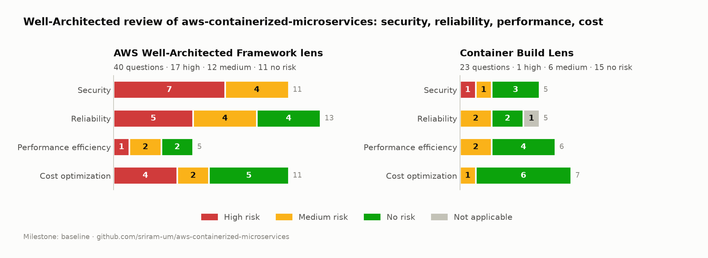

# Well-Architected review results — aws-containerized-microservices

Review of the architecture **as built** at the end of Phase 12 (repository `main` @ `8aae8bd`),
answered in the **AWS Well-Architected Tool** with the **Well-Architected Framework** lens and the
**Container Build Lens**, milestone **`v1.0-baseline`** (2026-11-01).

| | |
|---|---|
| **Scope** | Pillars **Security, Reliability (incl. disaster recovery), Performance Efficiency, Cost Optimization**. Operational Excellence and Sustainability were not reviewed (by request) and are left unanswered in the tool |
| **Workload** | ECS Fargate (+ Spot, ARM64) microservices behind an ALB in private subnets with VPC endpoints; Aurora PostgreSQL Global Database (us-east-1 + us-west-2); DynamoDB; Cognito; Secrets Manager; CodePipeline/CodeBuild/CodeDeploy blue/green; CloudFormation |
| **State** | Decommissioned after the build (Phase 13). The review uses the template, scripts, tests, README measurements and the cost estimate as evidence; nothing had to run |
| **Method** | Same as Project 3 ([how to do a review](https://github.com/sriram-um/aws-serverless-application/blob/main/well-architected-review/01-how-to-do-a-review.md)): answers as code in [`answers/`](answers/), a best practice is ticked **only with evidence** (file, setting or measurement), every note has *Evidence* and *Gap*; plus read-only account checks |

## Results

| Lens | Questions | 🔴 High | 🟠 Medium | 🟢 None | ⚪ N/A |
|---|---|---|---|---|---|
| Framework — Security | 11 | **7** | 4 | 0 | |
| Framework — Reliability | 13 | **5** | 4 | 4 | |
| Framework — Performance | 5 | **1** | 2 | 2 | |
| Framework — Cost | 11 | **4** | 2 | 5 | |
| **Framework total** | **40** | **17** | **12** | **11** | |
| Container Build Lens (same 4 pillars) | 23 | **1** | 6 | 15 | 1 |

120 Framework and 30 Container Build best practices are in place. The per-question table is in
the [appendix](#appendix-every-question).

**Reading the numbers:** the workload itself scores well where it was engineered and measured
(container build, compute, scaling, data stores, decommissioning). Most high risks come from two
places that the project never addressed: **the AWS account** (identity, logging, detection,
governance) and **things a production service needs beyond a demo** (HTTPS, notifications,
defined recovery objectives, incident response).

## What was done well

| Pillar | Strengths (evidence) |
|---|---|
| Security | No internet route from private subnets, only VPC endpoints; security groups chained by reference (ALB → app → DB); every IAM role scoped to single resources with `iam:PassRole` conditions; DB password generated in Secrets Manager and injected via `valueFrom`; encryption at rest everywhere; hardened images (slim, non-root, read-only root filesystem); token verification tested against tampering, wrong audience/issuer, expiry and token type |
| Reliability | Two AZs, AZ spread verified after deployments; health checks at every layer with `/health` independent of the DB; blue/green canary with alarm rollback (bad release reached 10.1 % instead of 100 %) and rolling deployments with circuit breaker; Spot interruption handled with an on-demand base task; graceful degradation (fast 503s, automatic recovery) |
| Disaster recovery | Aurora Global Database in a second Region, defined in IaC; managed switchover there and back **tested and measured** (47 s / 44 s, RPO 0; RPO lag < 1 s under writes); a scripted, re-runnable teardown |
| Performance | Choices driven by benchmarks: EC2 vs Fargate load tests (~260 vs ~470 req/s for 2 tasks), Lambda vs ECS latency; scaling measured step by step; keep-alive and drain settings tuned from metrics; purpose-built data stores |
| Cost | Every hourly-billed resource priced before deployment and switched off between demos; Fargate ARM + Spot; free gateway endpoints; a cost estimate with Price List API prices and scenarios; complete decommissioning |
| Container build | Multi-stage, prod-only dependencies, immutable SHA tags, ECR lifecycle policies, native ARM builds with layer cache, scan on push, signal handling, health checks, CPU/memory limits |

## High-risk issues, grouped by theme

### 1. Account security baseline (Security: securely operate, identities, detect, incident response; Container SEC2)

Found by the read-only account checks, not in the repository:

| Finding | Evidence |
|---|---|
| **Root user has an active access key** | `iam get-account-summary`: `AccountAccessKeysPresent: 1` (root MFA is on) |
| The only IAM user has **AdministratorAccess, no MFA**, and a long-lived access key | `list-mfa-devices`: 0; access key created 2026-10-24 |
| **No CloudTrail trail** in either Region | `describe-trails`: empty (only the 90-day event history) |
| **GuardDuty, Security Hub, AWS Config, IAM Access Analyzer: off** | No detectors, recorders or analyzers in us-east-1 or us-west-2 |
| Single account shared with other workloads; no AWS Organizations | `AWSOrganizationsNotInUseException` |

### 2. Data in transit (Security: protect data in transit)

The public listener is **HTTP :80 only**, so product data and the orders API's **bearer tokens**
cross the internet unencrypted. There's no domain, so no ACM certificate or HTTPS listener exists.
Inside AWS everything is TLS: Aurora with `sslmode=require`, AWS APIs via endpoints, TLS-only
bucket policies.

### 3. Application security process (Security: application security, data classification)

No second-person code review (direct pushes to `main`), no dependency or SAST scanning, no central
package repository, no penetration test. Basic ECR scanning covers OS packages only. There is no
data classification scheme (the data was demo data, but that was never written down).

### 4. Resilience mechanisms (Reliability: mitigate interaction failure, monitor, quotas, testing)

- **No request throttling**: no WAF or rate limits in front of the ALB; Project 3 had them.
- **No notifications to people**: alarms only trigger rollbacks and scaling; nobody is paged.
- **Quotas aren't monitored**: limits were hit and designed around, but none are watched.
- **Failure testing was manual and one-off**: deliberate failures were well measured, but there
  is no AWS FIS experiment, recurring game day or incident playbook.
- *Also noted (medium):* `POST /orders` isn't idempotent; the DynamoDB table has no PITR; each
  Aurora cluster has a single instance.

### 5. Disaster recovery (Reliability: plan for DR)

| | |
|---|---|
| In place | Aurora Global Database, secondary stack in IaC (no drift), managed switchover tested both ways with measured RTO (~45 s) and RPO (0; RPO lag < 1 s) |
| Why it's still high risk | **Recovery objectives were measured, not defined** as targets up front. **Only the database has DR**: no app, ALB or endpoints in us-west-2 and no DNS failover, so a regional outage stops the service even though the data survives. Recovery is a manual script; an *unplanned* failover (`--allow-data-loss`) was never exercised |

This was the agreed scope ("database-only DR"). The review makes the consequence explicit: the
database's RTO is about a minute, but the **application's** RTO for a regional outage is undefined.

### 6. Cost governance (Cost: financial management, govern usage, monitor usage, select service)

The engineering side of cost is strong; the **governance** side is missing. The `project` tag is
on every resource but **not activated** as a cost allocation tag, so actual cost per project can't
be reported. There are no written cost requirements or targets, no account per workload, no
enforcing controls (budget actions, SCPs), and no cost KPI such as cost per 1,000 requests.

### 7. Performance process (Performance: process and culture)

The workload was measured thoroughly, but there are **no KPIs/SLOs** (latency, error-rate targets),
no regular metric reviews, and no automated dependency or base-image updates.

## Improvement plan

Ordered by risk reduced per effort. Costs are us-east-1 list prices.

| # | Change | Effort | Running cost | Addresses |
|---|---|---|---|---|
| 1 | **Delete the root access key**; MFA for user `sriram`, then move people to IAM Identity Center (temporary credentials) | S | $0 | securely-operate, identities, permissions, Container SEC2 |
| 2 | **Multi-Region CloudTrail trail** (log file validation, S3 + lifecycle) | S | first management-event trail free + S3 cents | detect-investigate, incident-response |
| 3 | **GuardDuty + IAM Access Analyzer** (external access) in both Regions; Security Hub foundational checks | S | GuardDuty usage-based (small for this account, 30-day trial); Access Analyzer free; Security Hub per check | detect-investigate, permissions, protect-compute |
| 4 | **HTTPS**: domain + ACM certificate, :443 listener, redirect :80 | S | Route 53 zone $0.50/month + domain; ACM free | protect-data-transit |
| 5 | **Notifications**: SNS topic for the existing alarms, budget alerts by tag | S | ≈ $0 | monitor-aws-resources, withstand-component-failures |
| 6 | **Activate the `project` cost allocation tag**; budget per project; cost KPI on the dashboard | S | $0 | monitor-usage, cloud-financial-management |
| 7 | **AWS WAF** on the ALB with a rate-based rule and AWS managed rules | S | $5 + $1/rule per month + $0.60/M requests | mitigate-interaction-failure, network-protection |
| 8 | **Define targets**: RTO/RPO, SLOs (p95 latency, availability) and cost targets in the README; alarms on them | S | $0.10/alarm | planning-for-recovery, process-culture, select-service, govern-usage |
| 9 | Branch protection + PR review; Dependabot; ECR **enhanced scanning** (Inspector) | M | Inspector per image scan | application-security, Container SEC3/PERF4 |
| 10 | **Pilot-light app in us-west-2**: same template with a Region condition, ECR replication, Route 53 failover; FIS experiment + yearly game day | L | ECR replication cents; endpoints/ALB only during a failover or drill | planning-for-recovery, testing-resiliency, fault-isolation |
| 11 | Idempotency key for `POST /orders`; DynamoDB PITR; Aurora 7-day backups + a restore test | M | PITR $0.20/GB-month | prevent-interaction-failure, backing-up-data |
| 12 | Service Quotas alarms (Fargate vCPU, ENIs, ALB targets) | S | $0.10/alarm | manage-service-limits |
| 13 | Data classification note + security incident playbook | S | $0 | data-classification, incident-response |

Steps 1-6 are small, cost almost nothing, and address **9 of the 17** Framework high risks
(fully or in part); with steps 7, 8 and 13 it's 14 of 17. The other three (application security, resilience testing, quotas) need steps 9, 10 and 12.

## Accepted risks

| Risk | Why accepted |
|---|---|
| No secret rotation | Agreed for this demo (torn down after the build); documented how rotation would work (Phase 9) |
| Single Aurora instance per Region, 0.5-2 ACU | Demo sizing to keep cost at ≈ $0.12/h; AWS recommends ≥ 8 ACU and a reader for a busy global primary |
| HIGH CVEs in Debian base packages | No fixed versions available at build time (checked with `apt list --upgradable`) |
| Database-only DR | Agreed scope; the gap to full-application DR is documented above |
| Operational Excellence and Sustainability not reviewed | Out of scope for this review (by request) |

## Lessons from the review

- **The account was the weakest part again.** As in Project 3, the most serious findings
  (root access key, no MFA, no CloudTrail, no GuardDuty) came from read-only account checks, not
  from the repository. They are cheap to fix and affect every project in the account.
- **Measured isn't the same as defined.** The DR drill produced good numbers (RTO ~45 s, RPO 0),
  but without targets agreed up front the tool can't, and shouldn't, rate them as meeting
  objectives.
- **"None of these" vs. unanswered:** a question with nothing in place has to be answered
  explicitly with "None of these"; leaving it empty silently drops it from the risk counts.
- **Tool quirks:** the Container Build Lens has no lens alias (only an ARN, which can't be used
  as a file name), and the workload description is limited to 250 characters.

## Reports

`reports/baseline-wellarchitected.pdf` and `reports/baseline-containerbuild.pdf` are the official
reports from the tool. They are **not committed** (git-ignored) because they include account
findings. `reports/baseline-risks.json` holds the per-question risks behind the chart and table.

## Appendix: every question

**Framework**

| Pillar | Question | Risk |
|---|---|---|
| Security | How do you securely operate your workload? | 🔴 High |
| Security | How do you manage identities for people and machines? | 🔴 High |
| Security | How do you manage permissions for people and machines? | 🟠 Medium |
| Security | How do you detect and investigate security events? | 🔴 High |
| Security | How do you protect your network resources? | 🟠 Medium |
| Security | How do you protect your compute resources? | 🟠 Medium |
| Security | How do you classify your data? | 🔴 High |
| Security | How do you protect your data at rest? | 🟠 Medium |
| Security | How do you protect your data in transit? | 🔴 High |
| Security | How do you anticipate, respond to, and recover from incidents? | 🔴 High |
| Security | How do you incorporate and validate the security properties of applications throughout the design, development, and deployment lifecycle? | 🔴 High |
| Reliability | How do you manage service quotas and constraints? | 🔴 High |
| Reliability | How do you plan your network topology? | 🟢 None |
| Reliability | How do you design your workload service architecture? | 🟢 None |
| Reliability | How do you design interactions in a distributed system to prevent failures? | 🟠 Medium |
| Reliability | How do you design interactions in a distributed system to mitigate or withstand failures? | 🔴 High |
| Reliability | How do you monitor workload resources? | 🔴 High |
| Reliability | How do you design your workload to adapt to changes in demand? | 🟢 None |
| Reliability | How do you implement change? | 🟠 Medium |
| Reliability | How do you back up data? | 🟠 Medium |
| Reliability | How do you use fault isolation to protect your workload? | 🟢 None |
| Reliability | How do you design your workload to withstand component failures? | 🟠 Medium |
| Reliability | How do you test reliability? | 🔴 High |
| Reliability | How do you plan for disaster recovery (DR)? | 🔴 High |
| Performance | How do you select the appropriate cloud resources and architecture patterns for your workload? | 🟢 None |
| Performance | How do you select and use compute resources in your workload? | 🟢 None |
| Performance | How do you store, manage, and access data in your workload? | 🟠 Medium |
| Performance | How do you select and configure networking resources in your workload? | 🟠 Medium |
| Performance | What process do you use to support more performance efficiency for your workload? | 🔴 High |
| Cost | How do you implement cloud financial management? | 🔴 High |
| Cost | How do you govern usage? | 🔴 High |
| Cost | How do you monitor your cost and usage? | 🔴 High |
| Cost | How do you decommission resources? | 🟢 None |
| Cost | How do you evaluate cost when you select services? | 🔴 High |
| Cost | How do you meet cost targets when you select resource type, size and number? | 🟢 None |
| Cost | How do you use pricing models to reduce cost? | 🟢 None |
| Cost | How do you plan for data transfer charges? | 🟢 None |
| Cost | How do you manage demand, and supply resources? | 🟠 Medium |
| Cost | How do you evaluate new services? | 🟠 Medium |
| Cost | How do you evaluate the cost of effort? | 🟢 None |

**Container Build Lens**

| Pillar | Question | Risk |
|---|---|---|
| Security | How do you ensure that your container images are using least privilege identity? | 🟢 None |
| Security | How do you control access to your build infrastructure? | 🔴 High |
| Security | How do you detect and address vulnerabilities within your container image? | 🟢 None |
| Security | How do you manage your container image boundaries? | 🟠 Medium |
| Security | How do you handle data within your containerized applications? | 🟢 None |
| Reliability | How do you limit the amount of CPU and memory a container consumes? | 🟢 None |
| Reliability | How do you handle persistent data in a container application? | ⚪ N/A |
| Reliability | How do you automate building and testing of containers? | 🟠 Medium |
| Reliability | How do I cascade updates to a parent or base image? | 🟠 Medium |
| Reliability | How do you monitor the health of a container? | 🟢 None |
| Performance | How do you reduce the size of your container image? | 🟢 None |
| Performance | How do you reduce the pull time of your container image? | 🟢 None |
| Performance | How do you make sure to get consistent results for your target images? | 🟢 None |
| Performance | How do you make sure to use updated versions for parent images? | 🟠 Medium |
| Performance | How do you make sure you get consistent performance results over time? | 🟠 Medium |
| Performance | How do you optimize the size of your target image? | 🟢 None |
| Cost | How do you design your container build process to avoid unnecessary cost? | 🟠 Medium |
| Cost | Ensure that your container images contain only what is relevant for your application to run | 🟢 None |
| Cost | How do you reduce your container images size? | 🟢 None |
| Cost | How do you design your containerized application to support automatic scaling and graceful termination? | 🟢 None |
| Cost | How do you design your containerized application to support multiple CPU architectures? | 🟢 None |
| Cost | How do you minimize cost for your containerized application during startup time? | 🟢 None |
| Cost | What systems are you using to create your container build process? | 🟢 None |
